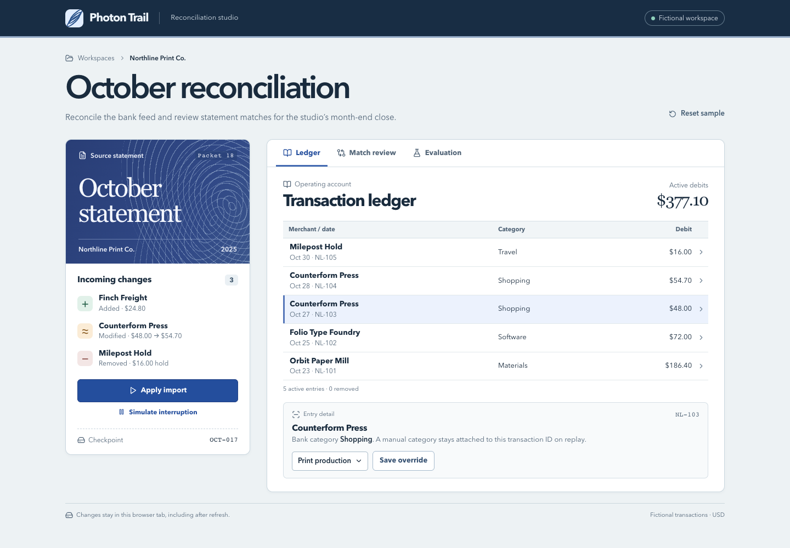

# Photon Trail

A bank can change an amount after the first import or withdraw a hold entirely. Two charges can also settle for the same amount at the same merchant. Photon Trail lets an operator replay the feed, inspect the evidence for a match and retain the decision that closes the ledger.



## Try the studio

The sample is a fictional October close for Northline Print Co. Run it with Node.js 20+ and open [the studio on localhost](http://localhost:3000/demo).

```sh
npm ci
npm run dev
```

1. In the ledger, the selected Oct 27 Counterform entry has the bank category **Shopping**. Choose **Print production** and save the override.
2. Select **Simulate interruption**. The new freight debit and the revised press charge land. The hold is still active and the checkpoint stays at `OCT-017`. Refresh the tab to recover the partial import.
3. In **Match review**, inspect the two $54.70 candidates for `ST-301`. The Oct 28 entry ranks first. The proof-run receipt identifies Oct 27. Confirm `NL-103`.
4. **Retry interrupted import** finishes the removal and advances to `OCT-018`. The closing ledger has six unique records, five active debits totaling **$392.60** and one withdrawn hold. **Replay import** changes zero ledger entries. Both reviewer decisions survive refresh.
5. Open **Evaluation** to inspect all five labeled outcomes. The weighted ranker gets **4/5**, including an abstention. The unique exact-merchant baseline gets **2/5**. The missed Counterform match is displayed alongside the expected ID.

The browser stores this sample's entries, checkpoint and decisions in session storage for the current tab. **Reset sample** restores its opening ledger. The sample makes no bank, model or database requests. To share the same UI as a portable file, run `npm run demo:export` and open `dist/demo/index.html`. It includes its scripts, icons and styles and can be served under a nested path.

## Inspect the implementation

| Question | Evidence |
| --- | --- |
| How does a repeat page converge? | The demo and connected sync consume the same ordered [page writes](lib/reconciliation/page.ts). The [Plaid sync](lib/plaid-sync.ts) upserts by provider ID, soft-removes withdrawn entries and saves the cursor after the final page. Reviewer categories live in a separate column. |
| What actually survives an interrupted database import? | A [PostgreSQL integration test](__tests__/sync-postgres.test.ts) applies the checked-in migration to disposable PGlite, fails the provider after one page, adds an override and delivers the same pages twice. It verifies IDs, amounts, category provenance, active rows and the cursor. The provider responses are fixtures. |
| Why did an entry rank first? | The [matcher](lib/reconciliation/matching.ts) fits character-trigram TF-IDF to active ledger merchants. It combines cosine similarity, amount proximity and date proximity. The UI shows each candidate's evidence. Scores below the threshold abstain. Close scores are flagged for review. |
| What did the comparison measure? | The [fixture](lib/reconciliation/fixture.ts) contains five hand-labeled lines for this packet. The [tests](__tests__/reconciliation.test.ts) check every labeled outcome, the close-call miss and an unseen spelling variant. The five-case score describes this fixture only. |

Run `npm test` for the database integration, ranking, replay, validator and AI-route tests. Run `npm run build` to compile the full Next.js app and type-check the connected routes. The studio's deterministic matcher operates on the sample statement. The connected app's OpenAI feature suggests transaction categories.

## Connected app

The signed-in product uses Google sessions, Plaid Link, a Neon/Postgres ledger, model suggestions with confidence and human category overrides. Configure a database, NextAuth, Google OAuth, Plaid sandbox credentials and a token-encryption key from [.env.example](.env.example). Set an OpenAI key to exercise connected categorization. Export the database variables into the shell for Drizzle commands.

```sh
cp .env.example .env.local
# Supply your own development configuration before running migrations.
npm run db:migrate
npm run dev
```

Transactions sync inline through an authenticated request or a webhook. Plaid tokens are encrypted at rest. The webhook uses an optional shared secret. Model requests use a per-process rate limit, bounded retries and validated output. The studio demonstrates recovery from sequential redelivery. Concurrent sync workers and live provider delivery are outside this fixture.

Built by [Aladdin Ali](https://github.com/NaxeCode). [MIT license](LICENSE).
